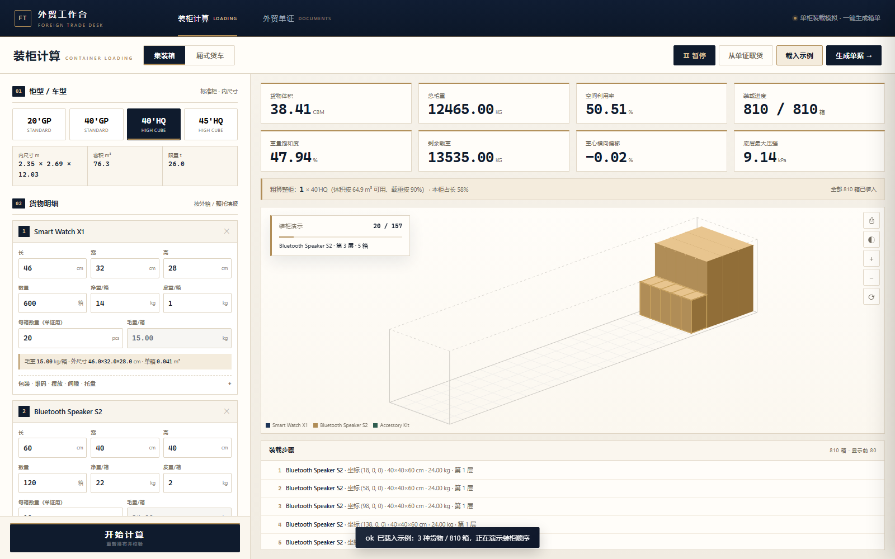

# 外贸单证与装柜工作台

一套离线外贸工作台：**形式发票 PI、商业发票、装箱单、销售合同、报关资料**，加上**集装箱 / 厢式货车装柜计算**与装柜方案 PDF。单文件 HTML，双击即用；商务藏青 + 香槟金视觉，另附一套 `shipment.json → PDF` 的 Agent 出单流水线。


## 功能

| 模块 | 能力 |
|---|---|
| 装柜计算 | 20GP / 40GP / 40HQ / 45HQ、4.2–7.6 米货车；多货物、包装填充、堆码/承压、摆放方向、间隙、整托；CBM、毛净重、装载率、重量饱和度、重心偏移、底层压强；逐箱坐标与装柜方案 PDF |
| 卖方信息 | 公司抬头、地址、税号、银行、Logo、公章、签名集中在一张卡；保存到本地，新建订单自动带出，所有单据共用 |
| 装柜动画 | 按装载顺序逐层播放装柜过程，画布上方显示进度、货物、层数与箱数；支持暂停 / 继续 / 重播 |
| 外贸单证 | 报价单、PI、CI、销售合同、装箱单、出口报关单、代理报关委托书；A4 实时预览、整套单据打印、金额大写、定金/尾款拆分、9 套配色、8 种单据语言 |
| 形式发票 | 银行信息、SWIFT、中间行、付款条款、有效期、金额大写、定金/尾款金额自动拆分 |
| Agent 流水线 | 一份 `shipment.json` → 单张或整套 PDF；装柜方案 PDF；字段校验与错误拦截 |

### 装柜动画



点「载入示例」或「开始计算」会自动播放逐层装柜动画；再次点击按钮可暂停、继续或重播。

### 单证界面


## 快速开始

### 1. 直接打开工作台

双击 `assets/workbench.html`，或拖进浏览器。无需服务器、无需联网、无 CDN 依赖。

单证页顶部有「卖方信息」卡：填一次、点「保存卖方信息」，之后新建订单/清空草稿都会自动带出。

顶部两个工作区：

- **装柜计算**：填箱规与数量 → 开始计算 → 看装载图/指标 → 打印装柜方案。
- **外贸单证**：选单据类型 → 填买卖双方/条款/货物 → 预览并打印 A4。

装柜页的「生成单据 →」会按箱规把货物写成 SKU 行并切到装箱单；单证页的「从单证取货」可反向导入。

### 2. 从 JSON 出 PDF

需要 Python 3.8+ 与本机 Chrome/Edge：

```bash
python scripts/render_docs.py assets/demo-shipment.json --out outputs --types PI
python scripts/render_docs.py assets/demo-shipment.json --out outputs --batch
python scripts/render_loading.py assets/demo-shipment.json --container 40HQ --out outputs
```

输出：

- `<订单>_PI.pdf` / `<订单>_docs.pdf`（PI + CI + PL）
- `<订单>_loading_40HQ.pdf`（装柜方案 + 逐箱坐标）
- `<订单>.draft.json`（可导入工作台继续改）

`assets/demo-shipment.json` 是完整示例，改它最快。字段口径见 [`references/shipment-schema.md`](references/shipment-schema.md)。

## 目录

```text
SKILL.md                  技能清单（SkillHub / Agent 入口）
assets/
  workbench.html          单文件工作台（装柜 + 单证）
  demo-shipment.json      示例订单
references/               字段、单据、Incoterms、装柜、报价
scripts/
  render_docs.py          shipment.json → 单证 PDF
  render_loading.py       shipment.json → 装柜方案 PDF
build/                    工作台源码（base.html + parts + 构建/打包脚本）
docs/                     README 截图
```

## 作为技能安装

### DSH / 本地 Agent

把仓库放到技能目录：

```bash
git clone https://github.com/southcul/demian-trade-suite.git ~/.dsh/skills/demian-trade-suite
```

技能入口是根目录的 `SKILL.md`。


## English

An offline, single-file workbench for foreign-trade documents (PI, CI, packing list, sales contract, Chinese customs forms) and container loading. It also ships a `shipment.json → PDF` pipeline for agents. Open `assets/workbench.html`; the scripts need Python 3.8+ and Chrome/Edge.

## License

MIT。见 [LICENSE](LICENSE)。
